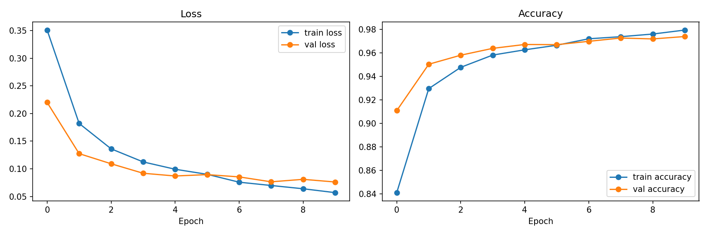
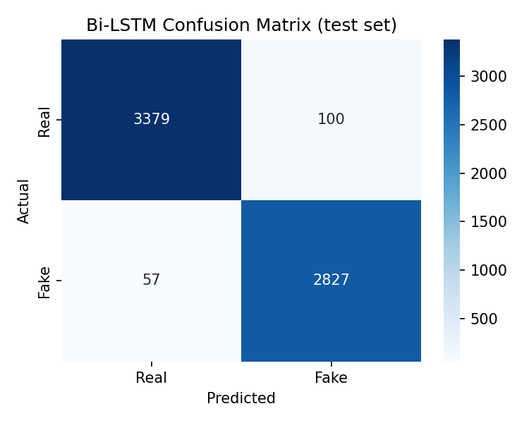
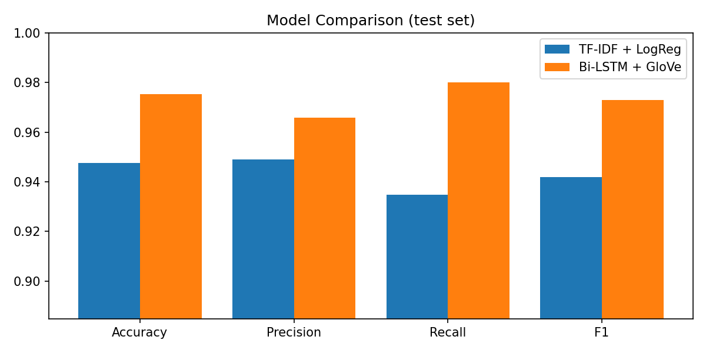

# 📰 Fake News Detection with Bi-LSTM + GloVe

A deep learning NLP project that classifies news articles as **REAL** or **FAKE** using a
**Bidirectional LSTM** with pre-trained **GloVe** word embeddings. It is trained on the
**WELFake** dataset (72K articles, 63.6K after removing duplicates), benchmarked against a TF-IDF + Logistic Regression baseline,
and deployed as a **Streamlit** web app.

[](https://fake-news-bilstm-fnr7gobkdzvi3w2eowl73c.streamlit.app/)


🚀 **Live demo:** [https://fake-news-bilstm-fnr7gobkdzvi3w2eowl73c.streamlit.app/](https://fake-news-bilstm-fnr7gobkdzvi3w2eowl73c.streamlit.app/)

---

## 🔍 Overview

Fake news spreads quickly on social media. This project trains a sequence model that reads the
headline and body of an article and outputs the probability that it is fake.

**Pipeline:**

```
Raw article → Cleaning (lowercase, URLs/HTML/punctuation, stop-words, dateline-leakage removal)
            → TextVectorization (50K vocab, 300 tokens)
            → GloVe 100d Embedding (frozen)
            → SpatialDropout → Bi-LSTM(64) → GlobalMaxPool → Dense(64) → Dropout → Sigmoid
```

## 📊 Results

Held-out test set of 6,363 articles (80/10/10 split of 63,623 de-duplicated articles).

| Model | Accuracy | Precision | Recall | F1 | ROC-AUC |
|---|---|---|---|---|---|
| TF-IDF + Logistic Regression (baseline) | 94.77% | 94.90% | 93.48% | 94.18% | 0.9888 |
| **Bi-LSTM + GloVe** | **97.53%** | **96.58%** | **98.02%** | **97.30%** | **0.9968** |

The Bi-LSTM improves F1 by **+3.12 points** over the baseline. Training took ~31 minutes on a laptop CPU (10 epochs).

<p align="center">
  <br>
  
  
</p>

## 🧠 Key design decisions

- **Bidirectional LSTM** reads text both ways, so each word's representation uses context
  before and after it.
- **GloVe embeddings** add semantic knowledge learned from 6B tokens, which helps with words
  that are rare in the training data.
- **GlobalMaxPooling** picks up the strongest signals (for example sensational phrases)
  from anywhere in the article.
- **Leakage guard:** many real articles in public datasets begin with an agency dateline such
  as `WASHINGTON (Reuters) -`. Models learn this shortcut and report inflated accuracy, so the
  preprocessing removes it from the article body *before* the title is joined on (so a long
  title can't hide it) to make the model learn real language patterns.
- **Negations kept:** "not", "no" and "never" are kept even though they are stop-words,
  because they change meaning.
- **Regularization:** SpatialDropout, Dropout, EarlyStopping (restores the best weights) and
  ReduceLROnPlateau.
- **Stratified train/val/test split (80/10/10)** with a fixed seed, so results are reproducible.

## 📁 Project structure

```
fake-news-bilstm/
├── app.py                  # Streamlit web app
├── config.py               # all hyper-parameters & paths
├── requirements.txt
├── data/                   # put WELFake_Dataset.csv here
├── glove/                  # GloVe vectors (downloaded)
├── models/                 # trained model (.keras, ~21 MB, committed)
├── outputs/                # metrics.json + plots
├── scripts/
│   └── download_glove.py
├── tests/
│   └── test_smoke.py       # pytest smoke tests (preprocessing + model)
└── src/
    ├── preprocess.py       # text cleaning
    ├── data_loader.py      # load / dedupe / split
    ├── model.py            # Bi-LSTM + GloVe loader
    ├── train.py            # training + baseline + evaluation
    └── predict.py          # CLI inference
```

## 🚀 Getting started

```bash
# 1. Set up the environment
git clone https://github.com/saiSathvikbharatula/fake-news-bilstm.git
cd fake-news-bilstm
python -m venv venv
source venv/bin/activate            # Windows: venv\Scripts\activate
pip install -r requirements.txt

# 2. Get the data  (see data/README.md)
#    -> data/WELFake_Dataset.csv

# 3. Get GloVe embeddings (~820 MB download)
python scripts/download_glove.py

# 4. Train  (quick test first, then the full run)
python -m src.train --sample 5000 --epochs 2
python -m src.train

# 5. Predict from the command line
python -m src.predict "Scientists confirm miracle cure that doctors don't want you to know about!"

# 6. Launch the web app
streamlit run app.py

# 7. Run the tests
pip install -r requirements-dev.txt
pytest
```

💡 **No GPU?** Train on the free GPU in [Google Colab](https://colab.research.google.com):
upload the project folder, set *Runtime → Change runtime type → GPU* and run the same commands
with a `!` prefix. The full training run takes about 5–10 minutes on a GPU.

## 🧪 Testing on unseen articles

I wrote new fake articles that are not in the dataset and ran them through the app:

| Test article (invented) | Style | Prediction | Correct? |
|---|---|---|---|
| "5G towers drain vitamin D… share before it's deleted!!!" | Sensational | FAKE (99.8%) | ✅ |
| "Lemon water and baking soda cure diabetes in 7 days" | Sensational | FAKE (100%) | ✅ |
| "WHO recommends daily dark chocolate for adults over 40" | Neutral news style | REAL (99.8%) | ❌ |
| "Bank of Japan to accept rice as payment for bonds" | Neutral news style | REAL (100%) | ❌ |

**Takeaway:** the model reliably flags sensational, clickbait-style misinformation, but a fabricated
story written in a calm news tone fools it. It detects the *style* of fake news, not falsehood.

## ⚠️ Limitations

- The model learns *writing style and word patterns*, not facts, so it cannot verify claims
  (see the tests above).
- Performance can drop on news topics or sources very different from the training data.
- English only.

## 🔮 Future work

- Fine-tune a transformer (DistilBERT / RoBERTa) and compare it with the Bi-LSTM
- Add LIME/SHAP explanations to highlight influential words
- Add an attention layer to visualize which words the model focuses on

## 📚 Dataset

Verma, P. K., Agrawal, P., Amorim, I., & Prodan, R. (2021). *WELFake: Word Embedding Over
Linguistic Features for Fake News Detection.* IEEE Transactions on Computational Social Systems.

## 👤 Author

**Sathvik Bharatula**: B.Tech CSE (AI & ML)
GitHub: [saiSathvikbharatula](https://github.com/saiSathvikbharatula)
